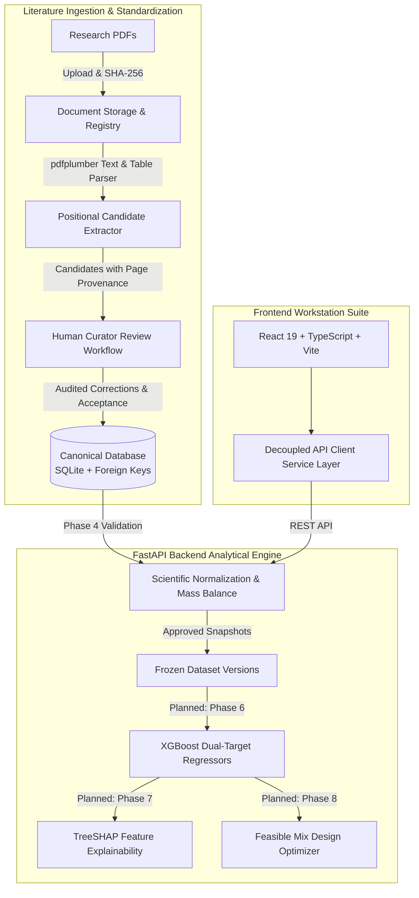

# FlyAsh Intel

<div align="center">

### XGBoost-Based Quality Prediction and Process Optimization for Sustainable Fly Ash Brick Manufacturing

[](https://www.python.org/)
[](https://fastapi.tiangolo.com/)
[](https://react.dev/)
[](https://www.typescriptlang.org/)
[](https://vitejs.dev/)
[](https://www.services.bis.gov.in/)
[](https://opensource.org/licenses/MIT)

*An end-to-end scientific research and engineering platform designed to ingest experimental literature, build a traceable canonical benchmark dataset, predict mechanical and durability performance with XGBoost, and prescribe Pareto-optimal mix formulations for sustainable masonry manufacturing.*

[Architecture](#system-architecture) • [Implementation Roadmap](#implementation-roadmap--status) • [Backend Setup](#backend-setup--api) • [Frontend Setup](#frontend-setup) • [Research Schema](#canonical-research-data-schema) • [Project Team](#project-team)

</div>

---

## Table of Contents
- [Project Overview & Problem Statement](#project-overview--problem-statement)
- [Approved Project Objectives](#approved-project-objectives)
- [System Architecture](#system-architecture)
- [Implementation Roadmap & Status](#implementation-roadmap--status)
- [Backend Setup & API](#backend-setup--api)
- [Frontend Setup & Workstation](#frontend-setup--workstation)
- [Canonical Research Data Schema & Integrity](#canonical-research-data-schema--integrity)
- [Literature PDF Ingestion & Provenance](#literature-pdf-ingestion--provenance)
- [Repository Structure](#repository-structure)
- [Automated Testing & Verification](#automated-testing--verification)
- [Academic References & Standards](#academic-references--standards)
- [Project Team](#project-team)
- [License & Intellectual Property](#license--intellectual-property)

---

## Project Overview & Problem Statement

In civil engineering and sustainable construction materials, pulverized fuel ash (coal fly ash) is an abundant industrial byproduct that offers an effective, low-carbon alternative to fertile clay topsoil and high-emission Portland cement. However, broad industrial adoption in masonry brick manufacturing faces several severe bottlenecks:

1. **Raw-Material Variability:** Ash characteristics (reactive silica, calcium oxide fraction, unburnt carbon / loss-on-ignition, and fineness) fluctuate significantly between power plant batches.
2. **Fragmented Research Literature:** Decades of empirical laboratory studies on fly ash-lime-gypsum (FaL-G), cement-bonded ash, and geopolymer mixes remain locked in heterogeneous scientific publications with inconsistent reporting notations.
3. **Trial-and-Error Manufacturing:** Production plants frequently rely on empirical heuristics, causing high batch-to-batch variance in 28-day compressive strength and water absorption that risks non-compliance with national building codes (e.g., IS 12894:2002).

**FlyAsh Intel** integrates materials informatics, machine learning surrogate models, and constrained optimization into a single, provenance-preserving platform to enable deterministic, quality-controlled fly ash brick manufacturing.

---

## Approved Project Objectives

In strict alignment with the approved research project specification ([PLAN.md](PLAN.md)), the platform fulfills three central objectives:

1. **Literature Extraction & Standardization:** Extract and standardize experimental fly ash brick formulation, manufacturing, and performance data from selected research publications while preserving source provenance.
2. **XGBoost-Based Quality Prediction:** Develop and evaluate XGBoost-based predictive models for compressive strength and water absorption using reviewed, comparable data and paper-grouped evaluation.
3. **Feasible Process Optimization:** Optimize and recommend candidate manufacturing formulations using XGBoost predictions, explicit feasibility constraints, uncertainty/extrapolation checks, and explainable results.

---

## System Architecture



---

## Implementation Roadmap & Status

| Phase | Description | Status | Verification & Deliverables |
|---|---|---|---|
| **Phase 1** | FastAPI backend skeleton, configuration, CORS, structured error masking, `/api/health`, `/api/ready` | **Completed** | Full suite contract tests passing |
| **Phase 2** | Canonical schema `v1.0.0-canonical`, SQLite persistence, paper registry, auditable review history, frozen dataset versions, synthetic data isolation | **Completed** | Strict FK enforcement, review logs, isolation tests |
| **Phase 3** | PDF ingestion, SHA-256 deduplication, path-traversal prevention, `pdfplumber` text/table parsing, candidate records with provenance, idempotent retries | **Completed** | 43 backend tests passing, scanned PDF detection |
| **Phase 4** | Scientific data validation, unit conversion registry, dry mass balance, water/binder verification, validation run persistence | **Underway** | Scientific constraint checks without zero-fabrication |
| **Phase 5** | Data readiness profiling snapshot, target comparability gates, exploratory analysis | *Deferred* | Planned (no models trained prior to readiness gate) |
| **Phase 6** | XGBoost dual-target training (strength & absorption), paper-grouped evaluation, baseline comparator | *Deferred* | Planned |
| **Phase 7** | TreeSHAP explainability engine, feature attribution, interaction effects | *Deferred* | Planned |
| **Phase 8** | Feasible mix design optimizer with constraint checks | *Deferred* | Planned |
| **Phase 9** | Full frontend workstation integration with live analytical endpoints | *Deferred* | Planned |

---

## Backend Setup & API

### Prerequisites
- **Python**: 3.12 (verified: 3.12.10)
- **Virtual Environment**: Recommended at `backend/.venv`

### 1. Installation
```powershell
# Navigate to repository root
cd d:\Projects\FlyAsh

# Create and activate virtual environment
python -m venv backend\.venv
.\backend\.venv\Scripts\Activate.ps1

# Install reproducible dependencies
pip install -r backend\requirements-lock.txt
```

### 2. Configuration
Copy the template configuration:
```powershell
cp backend\.env.example backend\.env
```
Key settings in `backend/app/core/config.py`:
- `DATABASE_URL`: `sqlite:///./backend/data/flyash.db`
- `DOCUMENTS_STORAGE_DIR`: `backend/data/documents`
- `MAX_UPLOAD_SIZE_BYTES`: `15728640` (15 MB)
- `CANONICAL_SCHEMA_VERSION`: `v1.0.0-canonical`

### 3. Run the Development Server
```powershell
.\backend\.venv\Scripts\uvicorn.exe backend.app.main:app --reload --port 8000
```
- Interactive OpenAPI Docs: `http://127.0.0.1:8000/docs`
- Liveness check: `http://127.0.0.1:8000/api/health`
- Readiness check: `http://127.0.0.1:8000/api/ready`

---

## Frontend Setup & Workstation

### Prerequisites
- **Node.js**: version 18.0 or higher
- **npm**: version 9.0 or higher

### 1. Installation & Local Execution
```powershell
# Install frontend dependencies
npm install

# Start Vite development server
npm run dev
```
Open `http://localhost:5173` in your browser.

### 2. Frontend Production Build & Linting
```powershell
# Run code quality linter
npm run lint

# Build production bundle
npm run build
```

---

## Canonical Research Data Schema & Integrity

### Record Grain
One record in `records` represents **one distinct experimental mix formulation and its resulting performance** under defined material systems, manufacturing conditions, curing regimens, and test standards. Replicates within the same test batch are aggregated as reported in the literature rather than artificially split.

### Research Integrity Rules
- **No Zero-Fabrication:** Missing or unmeasured constituents remain `null`. The system never fills unknown fractions with `0.0`.
- **Material System Separation:** Distinct material systems (e.g. `fly_ash_lime_gypsum_brick`, `fly_ash_cement_brick`, `geopolymer_brick`) are strictly segregated.
- **Terminology Preservation:** Raw materials like stone dust and quarry dust are maintained as distinct fields to avoid conflating different mineral aggregates.
- **Auditable Review History:** Any field correction applied via `PATCH /api/records/{id}/review` creates an immutable audit record in `review_history` capturing reviewer, timestamp, previous value, new value, and rationale.
- **Synthetic Data Isolation:** Synthetic records (`value_origin == "synthetic"`) are strictly barred from entering `model_ready` dataset version snapshots (`SYNTHETIC_DATA_LEAK_PREVENTED`).

---

## Literature PDF Ingestion & Provenance

Phase 3 introduces a secure literature ingestion pipeline:
1. **Document Registration:** `POST /api/documents/upload` accepts research PDFs up to 15 MB. Validates `%PDF-` header signature, generates a safe internal UUID storage path, and computes a cryptographic SHA-256 hash.
2. **Deduplication:** Duplicate uploads return the existing document metadata (`200 OK`) without writing redundant files to disk.
3. **Extraction Engine:** `POST /api/documents/{id}/extract` executes page-by-page text extraction and table parsing using `pdfplumber`. Positional column alignment links tabular proportions to canonical schema fields.
4. **Scanned PDF Honesty:** Scanned or image-only PDFs with minimal machine-readable text are flagged with `SCANNED_PDF_DETECTED`. Heavyweight OCR is not claimed or run.
5. **Separation of Candidates vs. Accepted Evidence:** Parser outputs enter as `candidate` records. They are never automatically accepted. Re-running extraction replaces only unreviewed candidates while preserving reviewed, accepted, or rejected records.

---

## Repository Structure

```text
flyash-brick-ai/
├── backend/
│   ├── app/
│   │   ├── api/
│   │   │   ├── routes/         # health, schema, papers, records, documents, datasets, models
│   │   │   └── router.py       # Central API v1 router
│   │   ├── core/               # config, errors, logging
│   │   ├── persistence/        # SQLAlchemy models, SQLite pragma, repositories
│   │   ├── schemas/            # Pydantic v2 validation contracts
│   │   ├── services/           # pdf_extractor, validation & normalization
│   │   └── main.py             # FastAPI entry point & lifespan
│   ├── tests/                  # Deterministic automated pytest suite
│   ├── requirements.txt        # Runtime dependencies
│   ├── requirements-lock.txt   # Reproducible pinned dependencies
│   └── README.md               # Backend-specific architecture & usage documentation
├── src/                        # React 19 + TypeScript + Vite frontend
│   ├── components/             # Reusable UI primitives, workstation views
│   ├── context/                # Theme management (Light/Dark/System)
│   ├── lib/api/                # Decoupled API service abstraction layer
│   └── types/                  # TypeScript interface contracts
├── PLAN.md                     # Authoritative engineering specification
├── package.json                # Frontend dependencies & build scripts
├── vite.config.ts              # Vite configuration
└── README.md                   # Repository overview & research guide
```

---

## Automated Testing & Verification

Run the complete backend test suite:
```powershell
.\backend\.venv\Scripts\pytest.exe backend\tests -v
```
- **43 automated tests** cover configuration, CORS, structured error masking, database persistence, foreign keys, transaction rollbacks, paper registry, review history, dataset snapshots, synthetic isolation, PDF upload validation, deduplication, `pdfplumber` extraction, scanned PDF detection, and idempotent retries.
- All tests execute deterministically against isolated temporary SQLite databases and synthetic in-memory PDFs without requiring external network connectivity.

Run frontend regression checks:
```powershell
npm run lint
npm run build
```

---

## Academic References & Standards

1. **Bureau of Indian Standards**. *IS 12894:2002 — Pulverized Fuel Ash-Lime Bricks — Specification*.
2. **Bureau of Indian Standards**. *IS 3812 (Part 1):2013 — Pulverized Fuel Ash — Specification for Use as Pozzolana in Cement, Cement Mortar and Concrete*.
3. **Bureau of Indian Standards**. *IS 3495 (Parts 1 to 4):2019 — Methods of Tests of Burnt Clay Building Bricks*.
4. **ASTM International**. *ASTM C618 — Standard Specification for Coal Fly Ash and Raw or Calcined Natural Pozzolan for Use in Concrete*.
5. **Kumar, S., & Prasad, J.** (2021). *Experimental Investigation on Pozzolanic Reactivity of Class F Fly Ash-Lime-Gypsum Bricks*. Construction and Building Materials.
6. **Turgut, P., & Algin, H. M.** (2020). *Steam-Cured Fly Ash-Quarry Dust Bricks for High-Strength Masonry Units*. ASCE Journal of Materials in Civil Engineering.

---

## Project Team

This project is developed as an academic major project in the **Department of Computer Engineering**:

| Team Member | Academic Program | Domain Focus |
|---|---|---|
| **Swayam Mandhani** | B.Tech Computer Engineering | Platform Architecture, ML Engineering & Lead |
| **Pruthviraj Mule** | B.Tech Computer Engineering | Data Engineering & Optimization |
| **Khush Paliwal** | B.Tech Computer Engineering | ML Modeling & Surrogate Evaluation |
| **Rohan Mungse** | B.Tech Computer Engineering | Pipeline Ingestion & UI/UX Engineering |

- **Institutional Department**: Department of Computer Engineering
- **Focus Area**: Materials Informatics, Applied Machine Learning, Sustainable Computing
- **Repository Maintainer**: [Swayam Mandhani](https://github.com/SwayamMandhani06)

---

## License & Intellectual Property

The source code of this software platform is released under the [MIT License](LICENSE).

> **Important Notice on Research Material & Literature**:  
> The MIT License applies exclusively to the platform source code in this repository. Academic research papers, publishers' copyrighted articles, citation abstracts, and literature-derived benchmark records remain the intellectual property of their respective authors and publishers.
