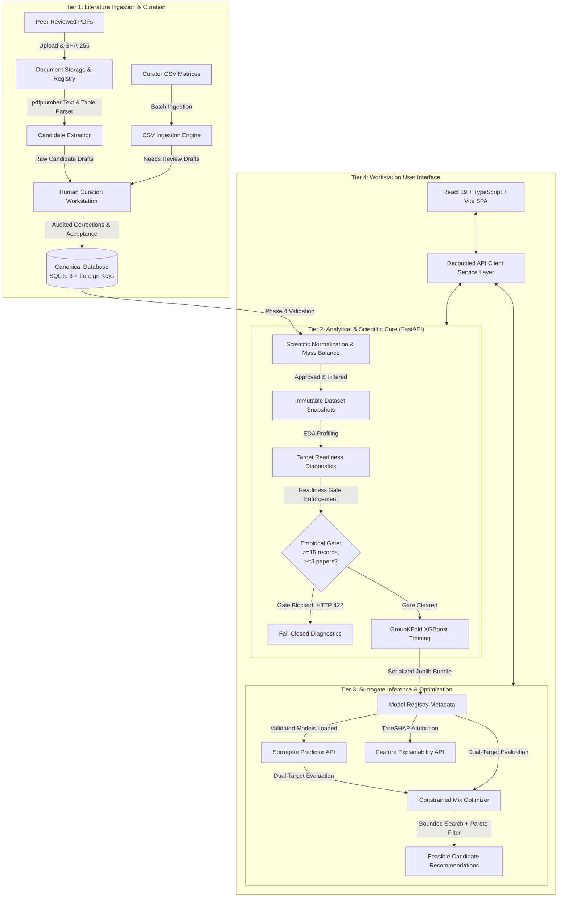

# System Architecture & Technical Specifications

**Project:** XGBoost-Based Quality Prediction and Process Optimization for Sustainable Fly Ash Brick Manufacturing
**Authoritative Plan Reference:** Root `PLAN.md` (Section 4 — Target Architecture)
**Applicability:** System engineering, dataflow design, component boundaries, and security architecture.

---

## 1. Architectural Philosophy & Core Principles

The platform is designed to bridge civil engineering materials science and predictive data engineering. It enforces four primary architectural principles:

1. **Decoupled Two-Tier Topology:** The frontend single-page application and backend analytical service operate independently over strongly typed REST contracts.
2. **Separation of Evidence and Decisions:** Raw PDF extractions and CSV batch imports are treated as untrusted draft candidates (`review_status == "candidate"` or `"needs_review"`). They never automatically enter empirical training sets.
3. **Fail-Closed Scientific Gates:** Subsystems that depend on validated empirical evidence (model training, surrogate inference, TreeSHAP attribution, and constrained optimization) fail closed (returning HTTP 422 or 503) whenever empirical evidence is insufficient or models are untrained.
4. **Complete Lineage & Provenance:** Every experimental record links to an authenticated literature publication (`paper_id`), an ingested document (`document_id`), and an exact citation location (page, table, figure, or excerpt).

---

## 2. End-to-End System Architecture

---

## 3. Subsystem Breakdown

### 3.1 Frontend Workstation Layer
- **Framework:** React 19.2 with TypeScript 6.0 and Vite 8.2.
- **Styling Architecture:** High-contrast responsive design system with CSS custom properties (variables) supporting Light, Dark, and System modes.
- **Service Abstraction:** Decoupled API service layer (`src/lib/api/services.ts`) communicating over HTTP/JSON with the backend REST endpoints.
- **Key Modules:**
  - `LiteratureIngestionPage`: PDF upload, cryptographic registration, and extraction progress tracking.
  - `DatasetPage`: Literature record browser, scatter visualizer, CSV export, and `ResearcherCurationPanel` (live readiness diagnostics and CSV batch curation).
  - `PredictionPage`: Interactive mix formulation input, IS 12894 structural compliance check, surrogate quality predictions, and fail-closed state handling.
  - `OptimizationPage`: Constrained formulation search workspace with multi-objective trade-off sliders and candidate recommendation cards.

### 3.2 Backend Analytical Service
- **Runtime:** Python 3.12 (verified on 3.12.10).
- **Web Framework:** FastAPI 0.115+ with Starlette ASGI runtime.
- **Contract Validation:** Pydantic v2 schemas for all request payloads, query parameters, and structured responses.
- **Error Handling:** Centralized exception handlers in `backend/app/core/errors.py` returning standard `{"error": {"code": ..., "message": ..., "details": ...}}` envelopes.

### 3.3 Relational Persistence Layer
- **Engine:** SQLite 3 via SQLAlchemy 2.x ORM.
- **File Location:** `backend/data/flyash.db`.
- **Integrity Constraints:**
  - Foreign key constraints enabled per connection via SQLAlchemy event listener (`PRAGMA foreign_keys=ON`).
  - Idempotent non-destructive table initialization via `init_db()`.
- **Schema Entities:**
  1. `papers`: Literature publication registry (title, authors, year, journal, DOI, material system).
  2. `documents`: Ingested PDF artifacts with SHA-256 deduplication and extraction status.
  3. `records`: Canonical experimental formulations and performance outcomes.
  4. `review_history`: Auditable append-only log of human curator corrections and status transitions.
  5. `validation_runs`: Versioned records of scientific validation executions.
  6. `validation_findings`: Itemized validation findings (rule code, category, severity, message).
  7. `dataset_versions`: Frozen immutable dataset snapshots with lifecycle states.
  8. `model_metadata`: Model registry records with training configuration, feature manifests, and metrics.
  9. `optimization_runs`: Audit history of formulation search executions and candidate outcomes.

### 3.4 Machine Learning & Explainability Pipeline
- **Core Library:** XGBoost 2.1+ regression engine.
- **Evaluation Protocol:**
  - Partitioning: Grouped cross-validation (`GroupKFold`) grouped strictly by `paper_id` to eliminate intra-publication laboratory leakage.
  - Baseline: `MeanBaselineRegressor` fit strictly on training folds to establish an honest performance floor.
  - Preprocessing: `TrainingFoldPreprocessor` computes medians exclusively within training folds.
- **Model Explainability:** TreeSHAP (`shap.TreeExplainer`) provides local additive feature attributions. Attributions are explicitly presented as model sensitivity metrics, not proof of chemical causality.

### 3.5 Constrained Formulation Optimizer
- **Search Method:** Deterministic bounded candidate grid/random search over physically viable mix boundaries.
- **Constraint Boundaries:**
  - Material System Segregation: FaL-G (`fly_ash_lime_gypsum_brick`) vs Cement–Fly Ash (`cement_fly_ash_brick`).
  - Mass Balance: Dry constituents must sum to $1.0 \pm 0.005$ with aggregate (sand/stone dust) serving as the slack balancing component.
  - Water Viability: Water dosage constrained within civil engineering bounds ($0.10 \le w \le 0.45$).
- **Multi-Objective Optimization:** Evaluates non-dominated Pareto frontiers across Compressive Strength (maximize), Water Absorption (minimize), and Fly Ash Utilization (maximize).

---

## 4. Scientific Integrity & Gating Architecture

| Gate Level | Enforcing Component | Trigger Condition | System Response |
|---|---|---|---|
| **Synthetic Isolation** | `DatasetVersionRepository` | Inclusion of `value_origin == "synthetic"` in a `model_ready` snapshot | `HTTP 422 SYNTHETIC_DATA_LEAK_PREVENTED` |
| **Model Training Gate** | `check_target_readiness_or_raise` | $< 15$ accepted empirical samples or $< 3$ independent papers | `HTTP 422 DATA_READINESS_BLOCKED` |
| **Surrogate Prediction Gate** | `predict_quality` route | Requested target model unregistered or unflagged `is_trained=True` | `HTTP 503 MODEL_UNAVAILABLE` |
| **TreeSHAP Explain Gate** | `explain_prediction` route | Requested target model unregistered or unflagged `is_trained=True` | `HTTP 503 MODEL_UNAVAILABLE` |
| **Optimization Gate** | `check_optimization_readiness` | Either target model unavailable or empirical database unready | `HTTP 503 OPTIMIZATION_UNAVAILABLE` |
