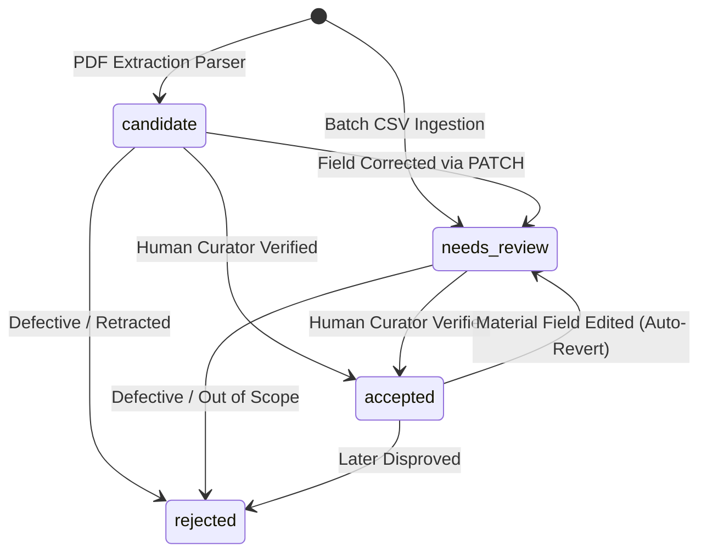

# Canonical Research Data Dictionary (`v1.0.0-canonical`)

**Project:** XGBoost-Based Quality Prediction and Process Optimization for Sustainable Fly Ash Brick Manufacturing
**Authoritative Plan Reference:** Root `PLAN.md` (Section 5 — Canonical Data Schema, Provenance, and State Model)
**Applicability:** Database schema, API payload serialization, validation rules, and researcher data curation.

---

## 1. Record Grain & Integrity Principles

### Record Grain
One record in the `records` table represents **one distinct experimental formulation and its physical performance outcome** under defined raw materials, manufacturing methods, curing regimen, and mechanical test standard. Specimen replicates within the same batch test are aggregated as reported in the primary research literature (e.g., reporting mean compressive strength across $n \ge 3$ specimens) rather than artificially split.

### Golden Rules of Evidence
1. **No Silent Rescaling or Zero-Fabrication:** Missing constituents, unreported water contents, or unmeasured test ages must remain `null` (`None`). The platform never substitutes `0.0` for missing values or silently normalizes partial mixes to 100%.
2. **Material Distinction:** Stone dust and quarry dust are maintained as distinct fields to respect original source terminology. Brick formulations, concrete mixes, geopolymer binders, and soil stabilization systems are segregated by `material_system`.
3. **Traceable Provenance:** Every record must link to an authenticated publication (`paper_id`) and an exact citation location within the paper.

---

## 2. Complete Field Specifications

### 2.1 Identifiers & Provenance
| Field Name | Type | Nullable | Canonical Unit / Format | Description & Validation Rules |
|---|---|---|---|---|
| `record_id` | String | No | `rec_<12hex>` | Unique record identifier; primary key. |
| `paper_id` | String | Yes | `paper_<12hex>` | Foreign key referencing `papers.paper_id`. Mandatory for accepted literature data. |
| `document_id` | String | Yes | `doc_<16hex>` | Foreign key referencing `documents.document_id`. |
| `experiment_group_id` | String | Yes | Text string | Groups shared batch series within the same publication to prevent intra-paper leakage. |
| `duplicate_group_id` | String | Yes | Text string | Cluster tag for potential duplicate reporting across publications. |
| `source_title` | String | Yes | Text string | Title of primary literature source. |
| `source_authors` | String | Yes | Text string | Author list as published in literature. |
| `publication_year` | Integer | Yes | YYYY ($1980 - 2030$) | Calendar year of publication. |
| `doi_or_url` | String | Yes | URI / DOI format | Digital Object Identifier or persistent URL. |
| `source_page` | String | Yes | Integer or range | 1-indexed page number within publication. |
| `source_table_or_figure` | String | Yes | Text string | Table or figure reference (e.g. `"Table 2"`). |
| `source_excerpt_or_cell_reference` | String | Yes | Text string | Direct textual excerpt or spreadsheet cell reference. |
| `raw_reported_values` | JSON/Dict | Yes | Key-value pairs | Unmodified parser or curator raw extraction dictionary. |

### 2.2 Administrative Lifecycle & Audit
| Field Name | Type | Nullable | Allowed Values | Description |
|---|---|---|---|---|
| `review_status` | String | No | `candidate`, `needs_review`, `accepted`, `rejected` | Current curation lifecycle state. Default: `candidate` (parser) or `needs_review` (CSV). |
| `reviewed_by` | String | Yes | Text string | Username or identifier of human curator. |
| `reviewed_at` | DateTime | Yes | ISO-8601 UTC | Timestamp of latest human review action. |
| `value_origin` | String | No | `literature_extracted`, `manual_entry`, `derived`, `synthetic` | Provenance classification. Synthetic records are quarantined from research sets. |
| `schema_version` | String | No | `"v1.0.0-canonical"` | Specification version string. |
| `extraction_method` | String | Yes | `"pdfplumber"`, `"csv_import"`, `"manual_entry"` | Tool or mechanism that generated the record. |
| `normalization_notes` | String | Yes | Text string | Curator narrative log explaining corrections. |

### 2.3 Material Composition
All formulation constituents are normalized to dry mass fractions ($0.0 - 1.0$) under canonical unit conversions while preserving raw reported basis.
| Field Name | Type | Nullable | Canonical Unit | Description & Engineering Bounds |
|---|---|---|---|---|
| `material_system` | String | No | Enumerated | e.g. `fly_ash_lime_gypsum_brick` (FaL-G), `fly_ash_cement_brick`, `fly_ash_clay_brick`. |
| `brick_state` | String | Yes | `fired`, `unfired`, `autoclaved`, `unknown` | Thermal processing classification. |
| `mix_basis` | String | Yes | `dry_mass_fraction`, `percentage`, `mass_ratio` | Basis of reported mix proportions. |
| `fly_ash_fraction` | Float | Yes | Decimal ($0.0 - 1.0$) | Pulverized fuel ash fraction by dry mass. Mandatory $> 0.0$ for fly ash bricks. |
| `cement_fraction` | Float | Yes | Decimal ($0.0 - 1.0$) | Ordinary Portland cement fraction. |
| `lime_fraction` | Float | Yes | Decimal ($0.0 - 1.0$) | Hydrated or quicklime fraction. |
| `gypsum_fraction` | Float | Yes | Decimal ($0.0 - 1.0$) | Phosphogypsum, mineral gypsum, or FGD gypsum fraction. |
| `sand_fraction` | Float | Yes | Decimal ($0.0 - 1.0$) | River sand or silica sand aggregate fraction. |
| `stone_dust_fraction` | Float | Yes | Decimal ($0.0 - 1.0$) | Crushed rock / stone dust fraction (kept distinct from quarry dust). |
| `quarry_dust_fraction` | Float | Yes | Decimal ($0.0 - 1.0$) | Quarry dust fraction (kept distinct from stone dust). |
| `other_materials` | JSON/Dict | Yes | Key-value pairs | Structured additives (e.g. bottom ash, slag, fibers) with reported fractions. |

### 2.4 Process & Manufacturing Parameters
| Field Name | Type | Nullable | Canonical Unit | Description |
|---|---|---|---|---|
| `water_content_or_ratio` | Float | Yes | Ratio or % | Water dosage reported in literature. Preserved as `null` if omitted. |
| `water_basis` | String | Yes | `water_binder_ratio`, `percentage_of_dry_mix` | Basis for interpreting water dosage. |
| `curing_method` | String | Yes | `ambient`, `water_immersion`, `steam`, `autoclave` | Environmental curing regimen. |
| `curing_duration_days` | Integer | Yes | Days ($1 - 365$) | Curing period prior to physical testing. |
| `curing_temperature_c` | Float | Yes | °C (Celsius) | Ambient or chamber curing temperature. |
| `compaction_pressure_mpa` | Float | Yes | MPa | Mechanical press compaction pressure applied during brick molding. |
| `density_kg_m3` | Float | Yes | $\text{kg/m}^3$ | Bulk dry density of manufactured masonry unit. |
| `specimen_dimensions` | String | Yes | Text string | Physical dimensions (e.g. `"230 x 110 x 70 mm"`). |
| `test_standard` | String | Yes | Text string | Mechanical testing standard (e.g. `"IS 3495"`, `"ASTM C67"`). |

### 2.5 Destructive Physical Performance Targets
| Field Name | Type | Nullable | Canonical Unit | Description & Classification |
|---|---|---|---|---|
| `compressive_strength_mpa` | Float | Yes | MPa | **Prediction Target 1:** Crushing strength under axial compression. |
| `water_absorption_pct` | Float | Yes | % by dry mass | **Prediction Target 2:** 24-hour cold immersion water absorption percentage. |
| `reported_value_type` | String | Yes | `mean`, `individual`, `median`, `range` | Statistical nature of reported target value. |
| `specimen_count_n` | Integer | Yes | Count ($n \ge 1$) | Number of brick specimens averaged in reported result. |
| `compressive_strength_sd_mpa` | Float | Yes | MPa | Standard deviation of compression tests within batch. |
| `water_absorption_sd_pct` | Float | Yes | % | Standard deviation of absorption tests within batch. |
| `failure_mode` | String | Yes | Text string | Destructive compression failure mode (quarantined from predictors). |
| `is12894_class_nominal` | String | Yes | Text string | Nominal IS 12894 strength class (e.g. `"Class 10"`). |
| `is12894_water_absorption_compliant` | Boolean | Yes | True / False | Whether water absorption satisfies $\le 20.0\%$ threshold. |

---

## 3. Review Lifecycle State Machine

### Transition Invariants
1. **Audit Logging:** Every field change on any record writes an immutable row into `review_history` capturing `field_name`, `previous_value`, `new_value`, `reviewer`, `reason`, and `timestamp`.
2. **Auto-Revert on Modification:** Editing any field of an `accepted` record automatically transitions its status back to `needs_review` to prevent unreviewed changes from silently contaminating downstream models.

---

## 4. Dataset Snapshot Lifecycle

Dataset snapshots created via `POST /api/datasets/versions` are classified into 5 immutable states:
- `raw`: Source extraction artifacts prior to human normalization.
- `candidate`: Ingested records awaiting human verification.
- `reviewed`: Records with completed human review decisions (mix of accepted and rejected).
- `model_ready`: Curated, non-synthetic, accepted records passing scientific validation and eligibility gates.
- `synthetic_test_only`: Isolated software fixtures reserved exclusively for automated testing.
